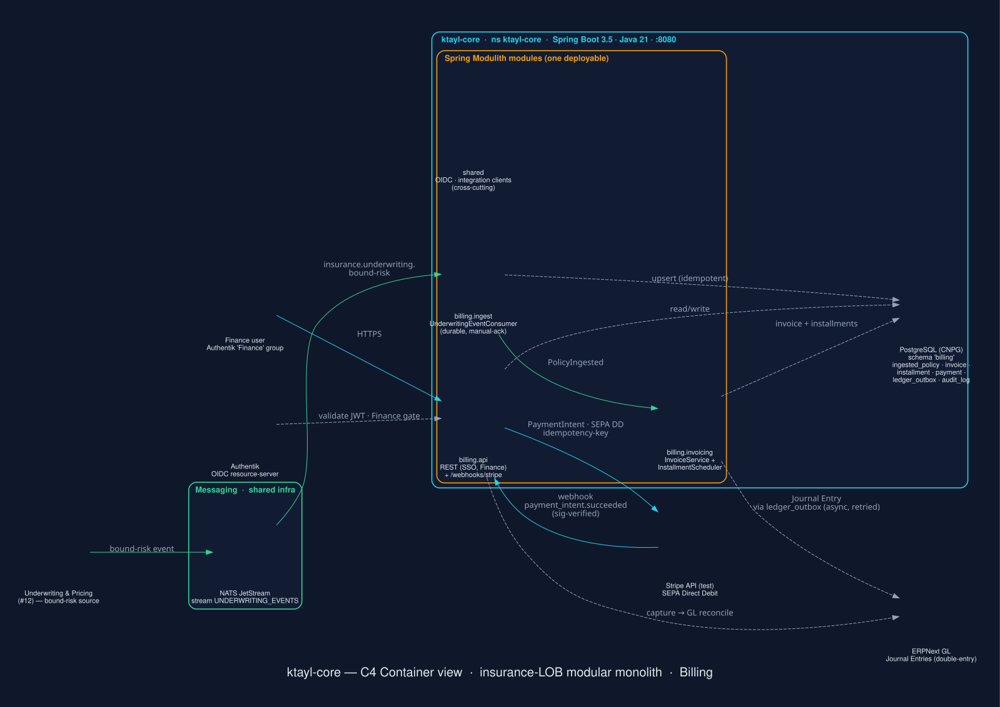

# C4 — Container view (ktayl-core)

> The container-level architecture of **ktayl-core**, the insurance-LOB **modular monolith**
> (Spring Boot + Spring Modulith, Java 21). First module: **Billing** (premium → cash → GL).
> This diagram is **generated from code** — [`docs/diagrams/ktayl_core_container.py`](../diagrams/ktayl_core_container.py)
> (mingrammer `diagrams` + Graphviz) — so it never drifts from a hand-drawn canvas. Edit the `.py`,
> run `python ktayl_core_container.py`, and commit the refreshed image.

*(If the SVG doesn't render in your viewer, the PNG is alongside it: `./img/ktayl-core-container.png`.)*

## What you're looking at

**One deployable** (a single Spring Boot JAR on `:8080`) that hosts business domains as **Spring
Modulith modules**, not separate services:

| Module | Visibility | Role |
|---|---|---|
| `billing` | CLOSED | Premium invoicing, installment schedule, SEPA Direct Debit capture (Stripe test), double-entry GL posting. Owns the `billing` schema. |
| `shared` | OPEN (cross-cutting) | Config, Authentik OIDC resource-server, integration clients (NATS JetStream, Stripe, ERPNext). No business logic. |

Inside `billing`, the boundary ports shown are `billing.ingest` (`UnderwritingEventConsumer`),
`billing.invoicing` (`InvoiceService` + `InstallmentScheduler`), and `billing.api` (SSO-gated REST +
the `/webhooks/stripe` inbound).

## Key flows (colour-coded on the diagram)

1. **Premium ingest (green, event-driven):** Underwriting publishes a **bound-risk event** to NATS
   JetStream (`insurance.underwriting.bound-risk`, stream `UNDERWRITING_EVENTS`); `billing.ingest`
   consumes it with a **durable, manual-ack** consumer and upserts `ingested_policy` (idempotent by
   policy number), emitting `PolicyIngested`.
2. **Invoicing:** `PolicyIngested` drives `billing.invoicing` to create the invoice + installment
   schedule in the `billing` schema.
3. **Payment (cyan):** the SSO-gated API creates a Stripe **PaymentIntent** (SEPA Direct Debit,
   idempotency-key); Stripe calls back `payment_intent.succeeded` to `/webhooks/stripe`
   (signature-verified, idempotent).
4. **GL posting (dashed, async):** invoicing/capture post **double-entry Journal Entries** to ERPNext
   via a transactional **outbox** (`ledger_outbox`) — retried, so an ERPNext blip never blocks billing.
5. **Auth:** Authentik (OIDC resource-server) validates the JWT and gates `/api/billing/**` on the
   **Finance** group.

## Boundaries

- **Owns:** the `billing` PostgreSQL schema (CNPG) — `ingested_policy`, `invoice`, `installment`,
  `payment`, `ledger_outbox`, `webhook_event`, `audit_log` (append-only).
- **Integrates with (external systems):** Underwriting (upstream event source), ERPNext GL, Stripe
  (test), Authentik — reached under a **default-deny egress** NetworkPolicy (`api.stripe.com` is the
  one SEC-approved external exception).

See the full SDD at [solution-architecture.md](./solution-architecture.md) (§3 System architecture,
§4 Data design, §5 API spec) and the decision log in [`adr/`](./adr).
