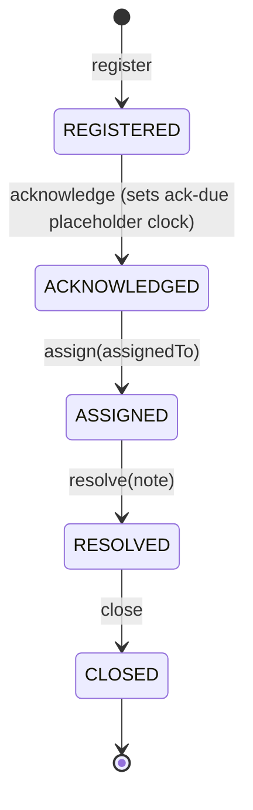

# Complaints & Disputes — as-built (CMPL-01 slice)

> The Phase-3 **greenfield vertical slice** of the ktayl-core modular monolith — the end-to-end proof of
> the modular-monolith + **hexagonal** pattern (ADR-013) on a real regulatory domain (ACPR/EIOPA/IDD
> complaint handling). Register → acknowledge → assign → resolve → close, SSO-gated, audited.
>
> SPEC: [`docs/specs/spec-complaints/SPEC.md`](../specs/spec-complaints/SPEC.md) ·
> ERD: [`docs/data-model/complaints.complaint.md`](../data-model/complaints.complaint.md) ·
> API: [`api/complaints.openapi.yaml`](../../api/complaints.openapi.yaml) ·
> ADR: [ADR-013 hexagonal](../architecture/adr/ADR-013-hexagonal-domain-independence.md)

## What it is

A module (`com.ktayl.core.complaints`) inside the single ktayl-core deployable — **not** a new service
(modular-monolith-first). It owns the `complaints` Postgres schema (schema-per-module, ADR-006) and
exposes a published `api` package; no other module reads its tables (CLOSED module, enforced by
`ModularityTests`).

## Hexagonal structure (ADR-013) — the business logic survives the tech

```
com.ktayl.core.complaints/
├── domain/          PURE Java (zero Spring/JPA): Complaint aggregate + state machine + invariants,
│                      ComplaintStatus/Channel, ComplaintRegistered event, ComplaintRepository PORT,
│                      the typed exceptions (Invalid / IllegalTransition / NotFound).
├── application/     use cases (Spring wiring, no rules): RegisterComplaint, ComplaintLifecycle,
│                      ComplaintService (implements the published port), AuditTrail port.
├── infrastructure/  adapters: persistence/ (JPA entity + Spring Data + adapters implementing the ports),
│                      web/ (ComplaintController + ComplaintExceptionHandler).
└── api/             PUBLISHED surface (Modulith NamedInterface): ComplaintOperations + ComplaintSummary
                       — java/primitive types only, no domain enum on the boundary.
```

Dependencies point **inward only** (`infrastructure → application → domain`); a `HexagonalArchitectureTests`
ArchUnit guard **fails the build** if `domain/` imports Spring/JPA or depends on `infrastructure`.

## Lifecycle (forward-only state machine)



Any transition from the wrong predecessor (or on a CLOSED complaint) → `IllegalComplaintTransitionException`
→ **409**. Every transition writes one append-only `complaints.audit_log` row (`from → to`, actor).

## HTTP surface

| Method | Path | Purpose |
|---|---|---|
| POST | `/api/complaints` | register (→ 201, `Idempotency-Key` safe-retry) |
| POST | `/api/complaints/{id}/acknowledge` | REGISTERED → ACKNOWLEDGED |
| POST | `/api/complaints/{id}/assign` | ACKNOWLEDGED → ASSIGNED |
| POST | `/api/complaints/{id}/resolve` | ASSIGNED → RESOLVED |
| POST | `/api/complaints/{id}/close` | RESOLVED → CLOSED |
| GET | `/api/complaints/{id}` | read `ComplaintSummary` (never the entity) |

**Security:** Authentik OIDC resource-server — valid token or **401**; the **`Complaints Handler`** group
(a `groups`-claim check via method security) or **403**. The actor is taken from the token
(`preferred_username`/subject) for audit attribution — never a placeholder. Error bodies are RFC-7807
`ProblemDetail` (404 / 409 / 422); malformed JSON stays Spring's 400 (never a 500).

> ⚠️ **PII / GDPR:** a complaint IS personal data. Access is identity-gated and audited; the published
> read model exposes only what a handler needs. Retention/erasure is a platform-level concern (not in this
> slice).

## Test layers (what proves it)

| Layer | Where | Proves |
|---|---|---|
| L1 domain (pure) | `complaints/domain/*Test` | register invariants, the full state machine (legal + every illegal transition), the ack-due `<`/`<=` boundary — no Spring, no DB |
| L1 use case | `complaints/application/*Test` | orchestration: load → mutate → persist → audit; idempotency; not-found; illegal-transition writes nothing |
| L2 persistence | `ComplaintPersistenceAdapterTest` | entity↔domain round-trip + lifecycle columns on real Postgres + Flyway (Testcontainers) |
| L3 contract | `ComplaintApiContractTest` | the HTTP contract: shapes + 404/409/422 + 401/403 + 400 (matches `complaints.openapi.yaml`) |
| guard | `ModularityTests`, `HexagonalArchitectureTests` | module boundary + domain purity (build fails on a breach) |
| **L4 / live QA** | **CMPL-014** | register→ack→close over the dev ingress + the observability triad — **pending the first ktayl-core deploy** |

## Status

CMPL-010 (skeleton) · 011 (register + event) · 012 (lifecycle + guards + ack-due) · 013 (API + REST + SSO
+ mapping) — **done, merged on `main`**. **CMPL-014 (deploy to dev + live QA gate) is pending** (the first
deploy of the whole ktayl-core workload — a shared billing+complaints milestone; see the deploy plan).
