# ktayl_core

## Tables

| Name                                                            | Columns | Comment | Type       |
| --------------------------------------------------------------- | ------- | ------- | ---------- |
| [billing.audit_log](billing.audit_log.md)                       | 7       |         | BASE TABLE |
| [billing.dunning_case](billing.dunning_case.md)                 | 8       |         | BASE TABLE |
| [billing.ingested_policy](billing.ingested_policy.md)           | 10      |         | BASE TABLE |
| [billing.installment](billing.installment.md)                   | 7       |         | BASE TABLE |
| [billing.invoice](billing.invoice.md)                           | 6       |         | BASE TABLE |
| [billing.ledger_outbox](billing.ledger_outbox.md)               | 11      |         | BASE TABLE |
| [billing.payment](billing.payment.md)                           | 9       |         | BASE TABLE |
| [billing.schema_marker](billing.schema_marker.md)               | 2       |         | BASE TABLE |
| [billing.webhook_event](billing.webhook_event.md)               | 4       |         | BASE TABLE |
| [complaints.audit_log](complaints.audit_log.md)                 | 7       |         | BASE TABLE |
| [complaints.complaint](complaints.complaint.md)                 | 10      |         | BASE TABLE |
| [complaints.schema_marker](complaints.schema_marker.md)         | 2       |         | BASE TABLE |
| [policy.policy](policy.policy.md)                               | 9       |         | BASE TABLE |
| [policy.policy_audit_log](policy.policy_audit_log.md)           | 8       |         | BASE TABLE |
| [screening.alert](screening.alert.md)                           | 5       |         | BASE TABLE |
| [screening.party](screening.party.md)                           | 9       |         | BASE TABLE |
| [screening.screening](screening.screening.md)                   | 6       |         | BASE TABLE |
| [screening.screening_audit](screening.screening_audit.md)       | 7       |         | BASE TABLE |
| [screening.screening_case](screening.screening_case.md)         | 8       |         | BASE TABLE |
| [submission.exposure_item](submission.exposure_item.md)         | 10      |         | BASE TABLE |
| [submission.submission](submission.submission.md)               | 10      |         | BASE TABLE |
| [submission.submission_triage](submission.submission_triage.md) | 8       |         | BASE TABLE |

## Relations

```mermaid
erDiagram

"billing.dunning_case" |o--|| "billing.installment" : "FOREIGN KEY (installment_id) REFERENCES installment(id)"
"billing.installment" }o--|| "billing.invoice" : "FOREIGN KEY (invoice_id) REFERENCES invoice(id)"
"billing.invoice" |o--|| "billing.ingested_policy" : "FOREIGN KEY (policy_number) REFERENCES ingested_policy(policy_number)"
"billing.payment" }o--|| "billing.installment" : "FOREIGN KEY (installment_id) REFERENCES installment(id)"
"policy.policy_audit_log" }o--|| "policy.policy" : "FOREIGN KEY (policy_id) REFERENCES policy.policy(id)"
"screening.alert" }o--|| "screening.screening" : "FOREIGN KEY (screening_id) REFERENCES screening.screening(id)"
"screening.screening" }o--|| "screening.party" : "FOREIGN KEY (party_id) REFERENCES screening.party(id)"
"screening.screening_case" |o--|| "screening.alert" : "FOREIGN KEY (alert_id) REFERENCES screening.alert(id)"
"submission.exposure_item" }o--|| "submission.submission" : "FOREIGN KEY (submission_id) REFERENCES submission.submission(id)"
"submission.submission_triage" }o--|| "submission.submission" : "FOREIGN KEY (submission_id) REFERENCES submission.submission(id)"

"billing.audit_log" {
  varchar_32_ action
  varchar_128_ actor
  timestamp_with_time_zone at
  text detail
  varchar_64_ entity
  varchar_128_ entity_id
  bigint id
}
"billing.dunning_case" {
  integer attempts
  timestamp_with_time_zone created_at
  uuid id
  uuid installment_id FK
  varchar_300_ last_reason
  varchar_64_ policy_number
  varchar_20_ status
  timestamp_with_time_zone updated_at
}
"billing.ingested_policy" {
  varchar_3_ currency
  date effective_date
  date expiry_date
  timestamp_with_time_zone ingested_at
  varchar_64_ policy_number
  bigint premium_minor
  varchar_64_ product_code
  varchar_64_ quote_id
  varchar_16_ status
  varchar_64_ submission_id
}
"billing.installment" {
  bigint amount_minor
  date due_date
  uuid id
  uuid invoice_id FK
  timestamp_with_time_zone paid_at
  integer seq
  varchar_16_ status
}
"billing.invoice" {
  varchar_3_ currency
  uuid id
  timestamp_with_time_zone issued_at
  varchar_64_ policy_number FK
  varchar_16_ status
  bigint total_minor
}
"billing.ledger_outbox" {
  bigint amount_minor
  integer attempts
  timestamp_with_time_zone created_at
  varchar_3_ currency
  varchar_32_ event_type
  uuid id
  varchar_500_ last_error
  timestamp_with_time_zone posted_at
  varchar_140_ posted_ref
  varchar_80_ reference
  varchar_16_ status
}
"billing.payment" {
  bigint amount_minor
  timestamp_with_time_zone captured_at
  varchar_80_ client_key
  timestamp_with_time_zone created_at
  varchar_3_ currency
  uuid id
  uuid installment_id FK
  varchar_128_ psp_intent_id
  varchar_16_ status
}
"billing.schema_marker" {
  timestamp_with_time_zone initialized
  varchar_64_ module
}
"billing.webhook_event" {
  timestamp_with_time_zone processed_at
  varchar_128_ psp_event_id
  timestamp_with_time_zone received_at
  varchar_64_ type
}
"complaints.audit_log" {
  varchar_64_ action
  varchar_128_ actor
  timestamp_with_time_zone at
  text detail
  varchar_64_ entity
  varchar_64_ entity_id
  bigint id
}
"complaints.complaint" {
  timestamp_with_time_zone acknowledgement_due_at
  varchar_128_ assigned_to
  varchar_16_ channel
  uuid id
  varchar_128_ idempotency_key
  timestamp_with_time_zone registered_at
  text resolution_note
  varchar_16_ status
  varchar_128_ subject_ref
  text summary
}
"complaints.schema_marker" {
  timestamp_with_time_zone initialized
  varchar_64_ module
}
"policy.policy" {
  timestamp_with_time_zone created_at
  date effective_date
  date expiry_date
  varchar_256_ holder_name
  uuid id
  varchar_64_ policy_number
  varchar_64_ product_code
  varchar_16_ status
  timestamp_with_time_zone updated_at
}
"policy.policy_audit_log" {
  varchar_32_ action
  varchar_128_ actor_id
  timestamp_with_time_zone at
  varchar_16_ from_status
  bigint id
  uuid policy_id FK
  varchar_256_ reason
  varchar_16_ to_status
}
"screening.alert" {
  varchar_16_ bucket
  uuid id
  text matched_entry
  integer score
  uuid screening_id FK
}
"screening.party" {
  timestamp_with_time_zone created_at
  date dob
  text external_ref
  uuid id
  text ids
  text name
  text nationality
  text residence
  text ubo_of
}
"screening.screening" {
  timestamp_with_time_zone at
  varchar_64_ dataset_version
  varchar_32_ gate
  uuid id
  uuid party_id FK
  varchar_8_ verdict
}
"screening.screening_audit" {
  varchar_32_ action
  varchar_128_ actor_id
  timestamp_with_time_zone at
  varchar_64_ dataset_version
  text detail
  bigint id
  uuid party_id
}
"screening.screening_case" {
  varchar_128_ actor_id
  uuid alert_id FK
  timestamp_with_time_zone decided_at
  uuid id
  varchar_512_ rationale
  varchar_8_ risk
  varchar_8_ status
  varchar_8_ vigilance
}
"submission.exposure_item" {
  boolean cat_flag
  varchar_64_ country
  timestamp_with_time_zone created_at
  varchar_8_ currency
  uuid id
  text loss_history
  varchar_128_ occupancy
  varchar_256_ site_name
  uuid submission_id FK
  numeric_18_2_ tiv_amount
}
"submission.submission" {
  varchar_128_ broker_ref
  uuid id
  varchar_256_ insured_name
  varchar_64_ product_line
  timestamp_with_time_zone received_at
  varchar_64_ routed_target
  uuid screening_alert_id
  boolean screening_hold
  varchar_16_ status
  timestamp_with_time_zone updated_at
}
"submission.submission_triage" {
  varchar_128_ actor
  varchar_32_ appetite_flag
  integer completeness_score
  timestamp_with_time_zone decided_at
  varchar_16_ decision
  bigint id
  text reason
  uuid submission_id FK
}
```

---

> Generated by [tbls](https://github.com/k1LoW/tbls)
