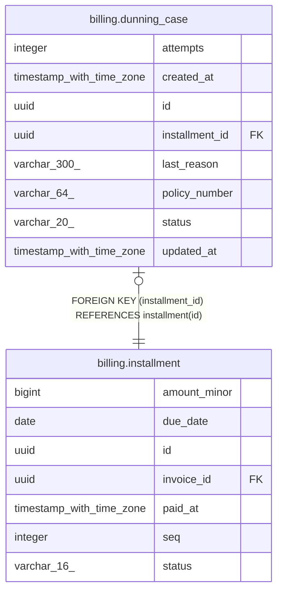

# billing.dunning_case

## Columns

| Name           | Type                     | Default                   | Nullable | Children | Parents                                       | Comment |
| -------------- | ------------------------ | ------------------------- | -------- | -------- | --------------------------------------------- | ------- |
| attempts       | integer                  | 0                         | false    |          |                                               |         |
| created_at     | timestamp with time zone | now()                     | false    |          |                                               |         |
| id             | uuid                     |                           | false    |          |                                               |         |
| installment_id | uuid                     |                           | false    |          | [billing.installment](billing.installment.md) |         |
| last_reason    | varchar(300)             |                           | true     |          |                                               |         |
| policy_number  | varchar(64)              |                           | false    |          |                                               |         |
| status         | varchar(20)              | 'open'::character varying | false    |          |                                               |         |
| updated_at     | timestamp with time zone | now()                     | false    |          |                                               |         |

## Constraints

| Name                             | Type        | Definition                                              |
| -------------------------------- | ----------- | ------------------------------------------------------- |
| dunning_case_installment_id_fkey | FOREIGN KEY | FOREIGN KEY (installment_id) REFERENCES installment(id) |
| dunning_case_installment_id_key  | UNIQUE      | UNIQUE (installment_id)                                 |
| dunning_case_pkey                | PRIMARY KEY | PRIMARY KEY (id)                                        |

## Indexes

| Name                            | Definition                                                                                               |
| ------------------------------- | -------------------------------------------------------------------------------------------------------- |
| dunning_case_installment_id_key | CREATE UNIQUE INDEX dunning_case_installment_id_key ON billing.dunning_case USING btree (installment_id) |
| dunning_case_pkey               | CREATE UNIQUE INDEX dunning_case_pkey ON billing.dunning_case USING btree (id)                           |
| idx_dunning_policy              | CREATE INDEX idx_dunning_policy ON billing.dunning_case USING btree (policy_number)                      |
| idx_dunning_status              | CREATE INDEX idx_dunning_status ON billing.dunning_case USING btree (status)                             |

## Relations

---

> Generated by [tbls](https://github.com/k1LoW/tbls)
