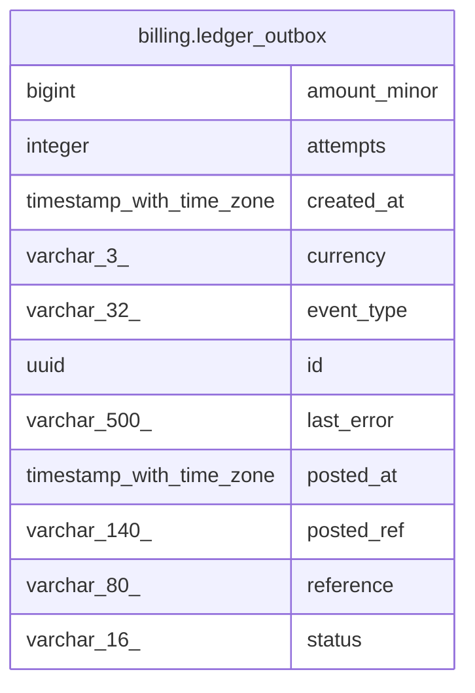

# billing.ledger_outbox

## Columns

| Name         | Type                     | Default                      | Nullable | Children | Parents | Comment |
| ------------ | ------------------------ | ---------------------------- | -------- | -------- | ------- | ------- |
| amount_minor | bigint                   |                              | false    |          |         |         |
| attempts     | integer                  | 0                            | false    |          |         |         |
| created_at   | timestamp with time zone | now()                        | false    |          |         |         |
| currency     | varchar(3)               |                              | false    |          |         |         |
| event_type   | varchar(32)              |                              | false    |          |         |         |
| id           | uuid                     |                              | false    |          |         |         |
| last_error   | varchar(500)             |                              | true     |          |         |         |
| posted_at    | timestamp with time zone |                              | true     |          |         |         |
| posted_ref   | varchar(140)             |                              | true     |          |         |         |
| reference    | varchar(80)              |                              | false    |          |         |         |
| status       | varchar(16)              | 'pending'::character varying | false    |          |         |         |

## Constraints

| Name                                   | Type        | Definition                     |
| -------------------------------------- | ----------- | ------------------------------ |
| ledger_outbox_amount_minor_check       | CHECK       | CHECK ((amount_minor > 0))     |
| ledger_outbox_event_type_reference_key | UNIQUE      | UNIQUE (event_type, reference) |
| ledger_outbox_pkey                     | PRIMARY KEY | PRIMARY KEY (id)               |

## Indexes

| Name                                   | Definition                                                                                                                    |
| -------------------------------------- | ----------------------------------------------------------------------------------------------------------------------------- |
| idx_ledger_outbox_pending              | CREATE INDEX idx_ledger_outbox_pending ON billing.ledger_outbox USING btree (status) WHERE ((status)::text = 'pending'::text) |
| ledger_outbox_event_type_reference_key | CREATE UNIQUE INDEX ledger_outbox_event_type_reference_key ON billing.ledger_outbox USING btree (event_type, reference)       |
| ledger_outbox_pkey                     | CREATE UNIQUE INDEX ledger_outbox_pkey ON billing.ledger_outbox USING btree (id)                                              |

## Relations

---

> Generated by [tbls](https://github.com/k1LoW/tbls)
