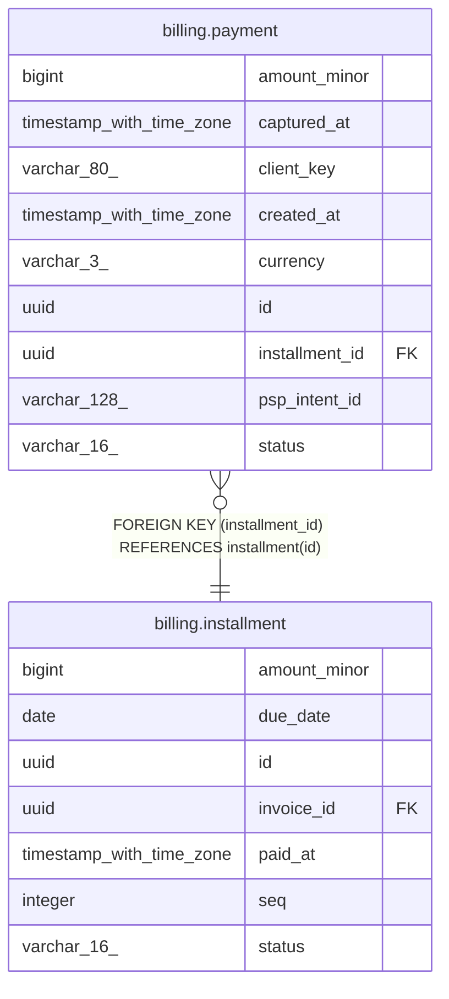

# billing.payment

## Columns

| Name           | Type                     | Default                      | Nullable | Children | Parents                                       | Comment |
| -------------- | ------------------------ | ---------------------------- | -------- | -------- | --------------------------------------------- | ------- |
| amount_minor   | bigint                   |                              | false    |          |                                               |         |
| captured_at    | timestamp with time zone |                              | true     |          |                                               |         |
| client_key     | varchar(80)              |                              | false    |          |                                               |         |
| created_at     | timestamp with time zone | now()                        | false    |          |                                               |         |
| currency       | varchar(3)               |                              | false    |          |                                               |         |
| id             | uuid                     |                              | false    |          |                                               |         |
| installment_id | uuid                     |                              | false    |          | [billing.installment](billing.installment.md) |         |
| psp_intent_id  | varchar(128)             |                              | true     |          |                                               |         |
| status         | varchar(16)              | 'pending'::character varying | false    |          |                                               |         |

## Constraints

| Name                        | Type        | Definition                                              |
| --------------------------- | ----------- | ------------------------------------------------------- |
| payment_amount_minor_check  | CHECK       | CHECK ((amount_minor > 0))                              |
| payment_client_key_key      | UNIQUE      | UNIQUE (client_key)                                     |
| payment_installment_id_fkey | FOREIGN KEY | FOREIGN KEY (installment_id) REFERENCES installment(id) |
| payment_pkey                | PRIMARY KEY | PRIMARY KEY (id)                                        |

## Indexes

| Name                    | Definition                                                                             |
| ----------------------- | -------------------------------------------------------------------------------------- |
| idx_payment_installment | CREATE INDEX idx_payment_installment ON billing.payment USING btree (installment_id)   |
| idx_payment_intent      | CREATE INDEX idx_payment_intent ON billing.payment USING btree (psp_intent_id)         |
| payment_client_key_key  | CREATE UNIQUE INDEX payment_client_key_key ON billing.payment USING btree (client_key) |
| payment_pkey            | CREATE UNIQUE INDEX payment_pkey ON billing.payment USING btree (id)                   |

## Relations

---

> Generated by [tbls](https://github.com/k1LoW/tbls)
