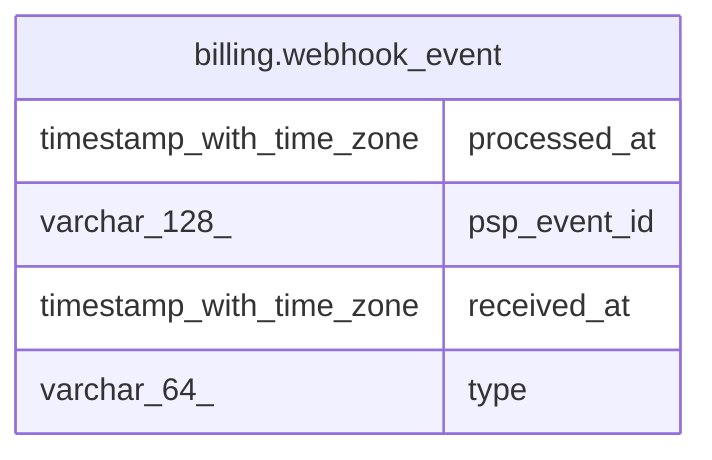

# billing.webhook_event

## Columns

| Name         | Type                     | Default | Nullable | Children | Parents | Comment |
| ------------ | ------------------------ | ------- | -------- | -------- | ------- | ------- |
| processed_at | timestamp with time zone |         | true     |          |         |         |
| psp_event_id | varchar(128)             |         | false    |          |         |         |
| received_at  | timestamp with time zone | now()   | false    |          |         |         |
| type         | varchar(64)              |         | false    |          |         |         |

## Constraints

| Name               | Type        | Definition                 |
| ------------------ | ----------- | -------------------------- |
| webhook_event_pkey | PRIMARY KEY | PRIMARY KEY (psp_event_id) |

## Indexes

| Name               | Definition                                                                                 |
| ------------------ | ------------------------------------------------------------------------------------------ |
| webhook_event_pkey | CREATE UNIQUE INDEX webhook_event_pkey ON billing.webhook_event USING btree (psp_event_id) |

## Relations

---

> Generated by [tbls](https://github.com/k1LoW/tbls)
