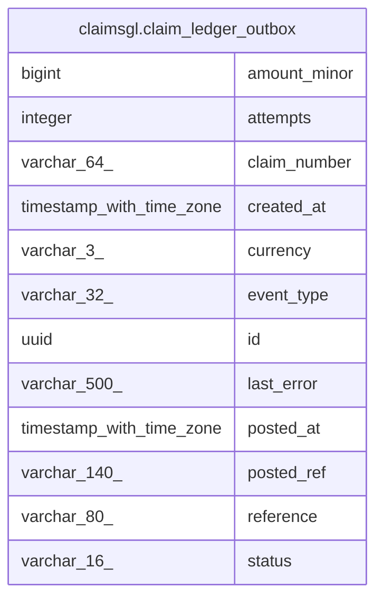

# claimsgl.claim_ledger_outbox

## Columns

| Name         | Type                     | Default                      | Nullable | Children | Parents | Comment |
| ------------ | ------------------------ | ---------------------------- | -------- | -------- | ------- | ------- |
| amount_minor | bigint                   |                              | false    |          |         |         |
| attempts     | integer                  | 0                            | false    |          |         |         |
| claim_number | varchar(64)              |                              | false    |          |         |         |
| created_at   | timestamp with time zone | now()                        | false    |          |         |         |
| currency     | varchar(3)               |                              | false    |          |         |         |
| event_type   | varchar(32)              |                              | false    |          |         |         |
| id           | uuid                     |                              | false    |          |         |         |
| last_error   | varchar(500)             |                              | true     |          |         |         |
| posted_at    | timestamp with time zone |                              | true     |          |         |         |
| posted_ref   | varchar(140)             |                              | true     |          |         |         |
| reference    | varchar(80)              |                              | false    |          |         |         |
| status       | varchar(16)              | 'pending'::character varying | false    |          |         |         |

## Constraints

| Name                                   | Type        | Definition                  |
| -------------------------------------- | ----------- | --------------------------- |
| claim_ledger_outbox_amount_minor_check | CHECK       | CHECK ((amount_minor <> 0)) |
| claim_ledger_outbox_pkey               | PRIMARY KEY | PRIMARY KEY (id)            |
| claim_ledger_outbox_reference_key      | UNIQUE      | UNIQUE (reference)          |

## Indexes

| Name                              | Definition                                                                                                                                 |
| --------------------------------- | ------------------------------------------------------------------------------------------------------------------------------------------ |
| claim_ledger_outbox_pkey          | CREATE UNIQUE INDEX claim_ledger_outbox_pkey ON claimsgl.claim_ledger_outbox USING btree (id)                                              |
| claim_ledger_outbox_reference_key | CREATE UNIQUE INDEX claim_ledger_outbox_reference_key ON claimsgl.claim_ledger_outbox USING btree (reference)                              |
| idx_claim_ledger_outbox_pending   | CREATE INDEX idx_claim_ledger_outbox_pending ON claimsgl.claim_ledger_outbox USING btree (status) WHERE ((status)::text = 'pending'::text) |

## Relations

---

> Generated by [tbls](https://github.com/k1LoW/tbls)
