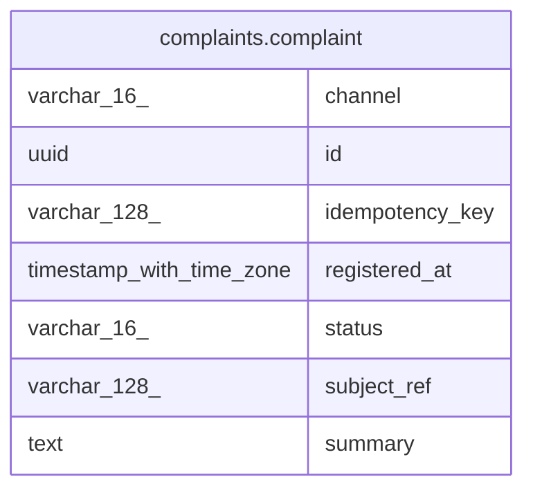

# complaints.complaint

## Columns

| Name            | Type                     | Default | Nullable | Children | Parents | Comment |
| --------------- | ------------------------ | ------- | -------- | -------- | ------- | ------- |
| channel         | varchar(16)              |         | false    |          |         |         |
| id              | uuid                     |         | false    |          |         |         |
| idempotency_key | varchar(128)             |         | true     |          |         |         |
| registered_at   | timestamp with time zone |         | false    |          |         |         |
| status          | varchar(16)              |         | false    |          |         |         |
| subject_ref     | varchar(128)             |         | true     |          |         |         |
| summary         | text                     |         | false    |          |         |         |

## Constraints

| Name           | Type        | Definition       |
| -------------- | ----------- | ---------------- |
| complaint_pkey | PRIMARY KEY | PRIMARY KEY (id) |

## Indexes

| Name                         | Definition                                                                                                                                 |
| ---------------------------- | ------------------------------------------------------------------------------------------------------------------------------------------ |
| complaint_pkey               | CREATE UNIQUE INDEX complaint_pkey ON complaints.complaint USING btree (id)                                                                |
| ux_complaint_idempotency_key | CREATE UNIQUE INDEX ux_complaint_idempotency_key ON complaints.complaint USING btree (idempotency_key) WHERE (idempotency_key IS NOT NULL) |

## Relations

---

> Generated by [tbls](https://github.com/k1LoW/tbls)
