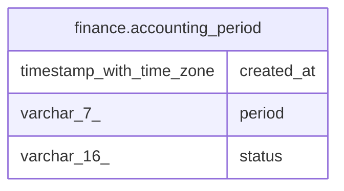

# finance.accounting_period

## Columns

| Name       | Type                     | Default                   | Nullable | Children | Parents | Comment |
| ---------- | ------------------------ | ------------------------- | -------- | -------- | ------- | ------- |
| created_at | timestamp with time zone | now()                     | false    |          |         |         |
| period     | varchar(7)               |                           | false    |          |         |         |
| status     | varchar(16)              | 'open'::character varying | false    |          |         |         |

## Constraints

| Name                           | Type        | Definition                                                                                               |
| ------------------------------ | ----------- | -------------------------------------------------------------------------------------------------------- |
| accounting_period_pkey         | PRIMARY KEY | PRIMARY KEY (period)                                                                                     |
| accounting_period_status_check | CHECK       | CHECK (((status)::text = ANY ((ARRAY['open'::character varying, 'closed'::character varying])::text[]))) |

## Indexes

| Name                   | Definition                                                                                   |
| ---------------------- | -------------------------------------------------------------------------------------------- |
| accounting_period_pkey | CREATE UNIQUE INDEX accounting_period_pkey ON finance.accounting_period USING btree (period) |

## Relations

---

> Generated by [tbls](https://github.com/k1LoW/tbls)
