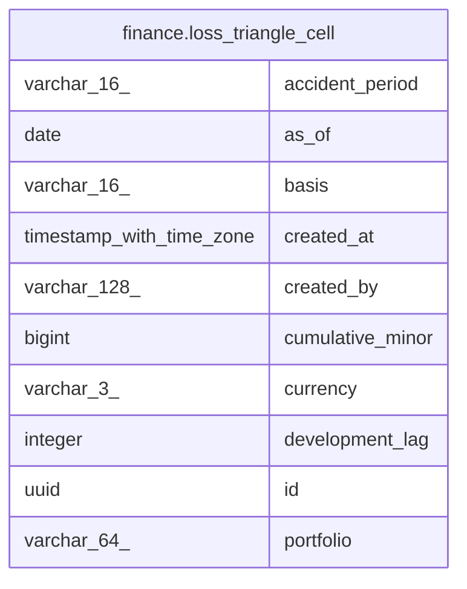

# finance.loss_triangle_cell

## Columns

| Name             | Type                     | Default | Nullable | Children | Parents | Comment |
| ---------------- | ------------------------ | ------- | -------- | -------- | ------- | ------- |
| accident_period  | varchar(16)              |         | false    |          |         |         |
| as_of            | date                     |         | false    |          |         |         |
| basis            | varchar(16)              |         | false    |          |         |         |
| created_at       | timestamp with time zone | now()   | false    |          |         |         |
| created_by       | varchar(128)             |         | false    |          |         |         |
| cumulative_minor | bigint                   |         | false    |          |         |         |
| currency         | varchar(3)               |         | false    |          |         |         |
| development_lag  | integer                  |         | false    |          |         |         |
| id               | uuid                     |         | false    |          |         |         |
| portfolio        | varchar(64)              |         | false    |          |         |         |

## Constraints

| Name                                      | Type        | Definition                                                                                                |
| ----------------------------------------- | ----------- | --------------------------------------------------------------------------------------------------------- |
| loss_triangle_cell_basis_check            | CHECK       | CHECK (((basis)::text = ANY ((ARRAY['PAID'::character varying, 'INCURRED'::character varying])::text[]))) |
| loss_triangle_cell_cumulative_minor_check | CHECK       | CHECK ((cumulative_minor >= 0))                                                                           |
| loss_triangle_cell_development_lag_check  | CHECK       | CHECK ((development_lag >= 0))                                                                            |
| loss_triangle_cell_pkey                   | PRIMARY KEY | PRIMARY KEY (id)                                                                                          |
| uq_triangle_cell                          | UNIQUE      | UNIQUE (portfolio, as_of, basis, accident_period, development_lag)                                        |

## Indexes

| Name                     | Definition                                                                                                                                 |
| ------------------------ | ------------------------------------------------------------------------------------------------------------------------------------------ |
| idx_triangle_cell_lookup | CREATE INDEX idx_triangle_cell_lookup ON finance.loss_triangle_cell USING btree (portfolio, as_of, basis)                                  |
| loss_triangle_cell_pkey  | CREATE UNIQUE INDEX loss_triangle_cell_pkey ON finance.loss_triangle_cell USING btree (id)                                                 |
| uq_triangle_cell         | CREATE UNIQUE INDEX uq_triangle_cell ON finance.loss_triangle_cell USING btree (portfolio, as_of, basis, accident_period, development_lag) |

## Relations

---

> Generated by [tbls](https://github.com/k1LoW/tbls)
