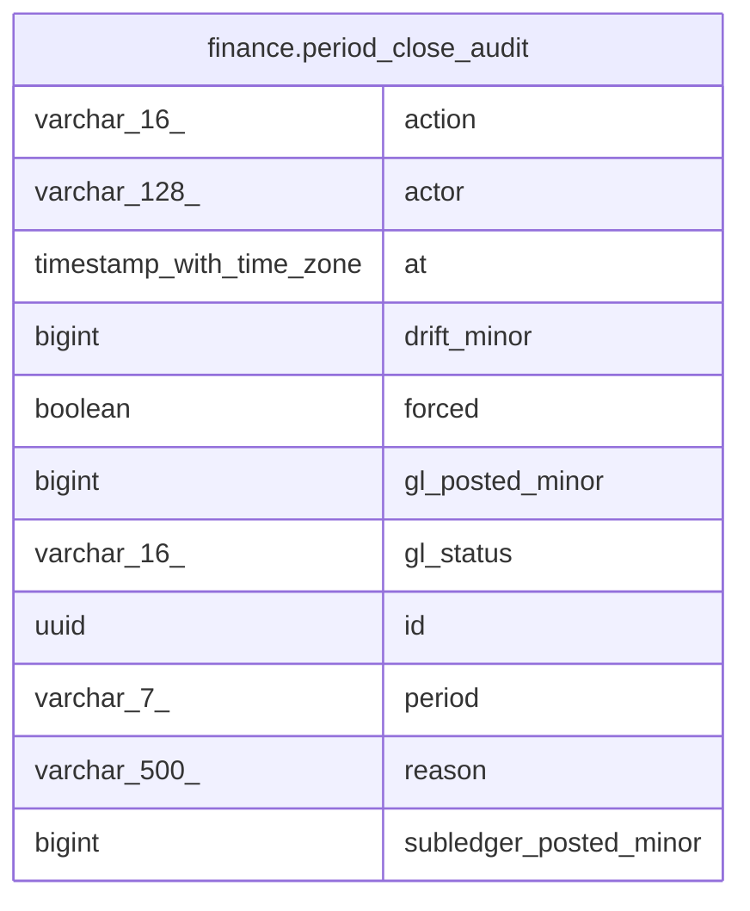

# finance.period_close_audit

## Columns

| Name                   | Type                     | Default | Nullable | Children | Parents | Comment |
| ---------------------- | ------------------------ | ------- | -------- | -------- | ------- | ------- |
| action                 | varchar(16)              |         | false    |          |         |         |
| actor                  | varchar(128)             |         | false    |          |         |         |
| at                     | timestamp with time zone | now()   | false    |          |         |         |
| drift_minor            | bigint                   |         | true     |          |         |         |
| forced                 | boolean                  | false   | false    |          |         |         |
| gl_posted_minor        | bigint                   |         | true     |          |         |         |
| gl_status              | varchar(16)              |         | true     |          |         |         |
| id                     | uuid                     |         | false    |          |         |         |
| period                 | varchar(7)               |         | false    |          |         |         |
| reason                 | varchar(500)             |         | true     |          |         |         |
| subledger_posted_minor | bigint                   |         | true     |          |         |         |

## Constraints

| Name                            | Type        | Definition                                                                                                   |
| ------------------------------- | ----------- | ------------------------------------------------------------------------------------------------------------ |
| period_close_audit_action_check | CHECK       | CHECK (((action)::text = ANY ((ARRAY['CLOSED'::character varying, 'REOPENED'::character varying])::text[]))) |
| period_close_audit_pkey         | PRIMARY KEY | PRIMARY KEY (id)                                                                                             |

## Indexes

| Name                          | Definition                                                                                        |
| ----------------------------- | ------------------------------------------------------------------------------------------------- |
| idx_period_close_audit_period | CREATE INDEX idx_period_close_audit_period ON finance.period_close_audit USING btree (period, at) |
| period_close_audit_pkey       | CREATE UNIQUE INDEX period_close_audit_pkey ON finance.period_close_audit USING btree (id)        |

## Relations

---

> Generated by [tbls](https://github.com/k1LoW/tbls)
