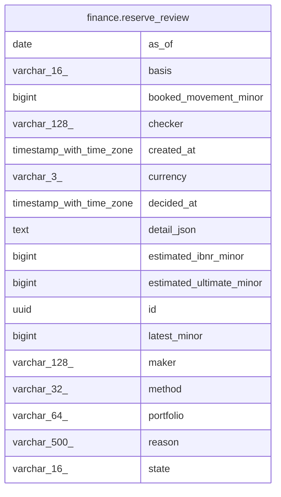

# finance.reserve_review

## Columns

| Name                     | Type                     | Default                      | Nullable | Children | Parents | Comment |
| ------------------------ | ------------------------ | ---------------------------- | -------- | -------- | ------- | ------- |
| as_of                    | date                     |                              | false    |          |         |         |
| basis                    | varchar(16)              |                              | false    |          |         |         |
| booked_movement_minor    | bigint                   |                              | true     |          |         |         |
| checker                  | varchar(128)             |                              | true     |          |         |         |
| created_at               | timestamp with time zone | now()                        | false    |          |         |         |
| currency                 | varchar(3)               |                              | false    |          |         |         |
| decided_at               | timestamp with time zone |                              | true     |          |         |         |
| detail_json              | text                     |                              | false    |          |         |         |
| estimated_ibnr_minor     | bigint                   |                              | false    |          |         |         |
| estimated_ultimate_minor | bigint                   |                              | false    |          |         |         |
| id                       | uuid                     |                              | false    |          |         |         |
| latest_minor             | bigint                   |                              | false    |          |         |         |
| maker                    | varchar(128)             |                              | false    |          |         |         |
| method                   | varchar(32)              |                              | false    |          |         |         |
| portfolio                | varchar(64)              |                              | false    |          |         |         |
| reason                   | varchar(500)             |                              | true     |          |         |         |
| state                    | varchar(16)              | 'PENDING'::character varying | false    |          |         |         |

## Constraints

| Name                        | Type        | Definition                                                                                                                                  |
| --------------------------- | ----------- | ------------------------------------------------------------------------------------------------------------------------------------------- |
| reserve_review_method_check | CHECK       | CHECK (((method)::text = ANY ((ARRAY['CHAIN_LADDER'::character varying, 'BORNHUETTER_FERGUSON'::character varying])::text[])))              |
| reserve_review_pkey         | PRIMARY KEY | PRIMARY KEY (id)                                                                                                                            |
| reserve_review_state_check  | CHECK       | CHECK (((state)::text = ANY ((ARRAY['PENDING'::character varying, 'APPROVED'::character varying, 'REJECTED'::character varying])::text[]))) |

## Indexes

| Name                         | Definition                                                                                                                  |
| ---------------------------- | --------------------------------------------------------------------------------------------------------------------------- |
| idx_reserve_review_portfolio | CREATE INDEX idx_reserve_review_portfolio ON finance.reserve_review USING btree (portfolio, created_at)                     |
| idx_reserve_review_state     | CREATE INDEX idx_reserve_review_state ON finance.reserve_review USING btree (state) WHERE ((state)::text = 'PENDING'::text) |
| reserve_review_pkey          | CREATE UNIQUE INDEX reserve_review_pkey ON finance.reserve_review USING btree (id)                                          |

## Relations

---

> Generated by [tbls](https://github.com/k1LoW/tbls)
