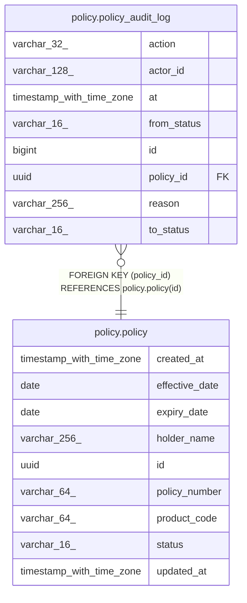

# policy.policy

## Columns

| Name           | Type                     | Default                    | Nullable | Children                                              | Parents | Comment |
| -------------- | ------------------------ | -------------------------- | -------- | ----------------------------------------------------- | ------- | ------- |
| created_at     | timestamp with time zone | now()                      | false    |                                                       |         |         |
| effective_date | date                     |                            | false    |                                                       |         |         |
| expiry_date    | date                     |                            | false    |                                                       |         |         |
| holder_name    | varchar(256)             |                            | false    |                                                       |         |         |
| id             | uuid                     |                            | false    | [policy.policy_audit_log](policy.policy_audit_log.md) |         |         |
| policy_number  | varchar(64)              |                            | false    |                                                       |         |         |
| product_code   | varchar(64)              |                            | false    |                                                       |         |         |
| status         | varchar(16)              | 'DRAFT'::character varying | false    |                                                       |         |         |
| updated_at     | timestamp with time zone | now()                      | false    |                                                       |         |         |

## Constraints

| Name                     | Type        | Definition                                                                                                                                                                                                                                                           |
| ------------------------ | ----------- | -------------------------------------------------------------------------------------------------------------------------------------------------------------------------------------------------------------------------------------------------------------------- |
| chk_policy_dates         | CHECK       | CHECK ((effective_date < expiry_date))                                                                                                                                                                                                                               |
| chk_policy_status        | CHECK       | CHECK (((status)::text = ANY ((ARRAY['DRAFT'::character varying, 'SUBMITTED'::character varying, 'ACTIVE'::character varying, 'AMENDED'::character varying, 'CANCELLED'::character varying, 'EXPIRED'::character varying, 'REJECTED'::character varying])::text[]))) |
| policy_pkey              | PRIMARY KEY | PRIMARY KEY (id)                                                                                                                                                                                                                                                     |
| policy_policy_number_key | UNIQUE      | UNIQUE (policy_number)                                                                                                                                                                                                                                               |

## Indexes

| Name                     | Definition                                                                                |
| ------------------------ | ----------------------------------------------------------------------------------------- |
| idx_policy_status        | CREATE INDEX idx_policy_status ON policy.policy USING btree (status)                      |
| policy_pkey              | CREATE UNIQUE INDEX policy_pkey ON policy.policy USING btree (id)                         |
| policy_policy_number_key | CREATE UNIQUE INDEX policy_policy_number_key ON policy.policy USING btree (policy_number) |

## Relations

---

> Generated by [tbls](https://github.com/k1LoW/tbls)
