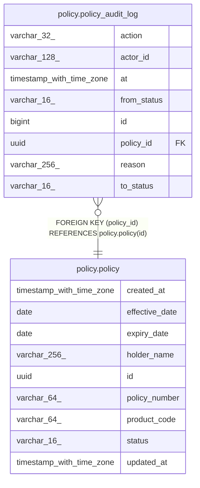

# policy.policy_audit_log

## Columns

| Name        | Type                     | Default | Nullable | Children | Parents                           | Comment |
| ----------- | ------------------------ | ------- | -------- | -------- | --------------------------------- | ------- |
| action      | varchar(32)              |         | false    |          |                                   |         |
| actor_id    | varchar(128)             |         | false    |          |                                   |         |
| at          | timestamp with time zone | now()   | false    |          |                                   |         |
| from_status | varchar(16)              |         | false    |          |                                   |         |
| id          | bigint                   |         | false    |          |                                   |         |
| policy_id   | uuid                     |         | false    |          | [policy.policy](policy.policy.md) |         |
| reason      | varchar(256)             |         | true     |          |                                   |         |
| to_status   | varchar(16)              |         | false    |          |                                   |         |

## Constraints

| Name                            | Type        | Definition                                           |
| ------------------------------- | ----------- | ---------------------------------------------------- |
| policy_audit_log_pkey           | PRIMARY KEY | PRIMARY KEY (id)                                     |
| policy_audit_log_policy_id_fkey | FOREIGN KEY | FOREIGN KEY (policy_id) REFERENCES policy.policy(id) |

## Indexes

| Name                    | Definition                                                                              |
| ----------------------- | --------------------------------------------------------------------------------------- |
| idx_policy_audit_policy | CREATE INDEX idx_policy_audit_policy ON policy.policy_audit_log USING btree (policy_id) |
| policy_audit_log_pkey   | CREATE UNIQUE INDEX policy_audit_log_pkey ON policy.policy_audit_log USING btree (id)   |

## Relations

---

> Generated by [tbls](https://github.com/k1LoW/tbls)
