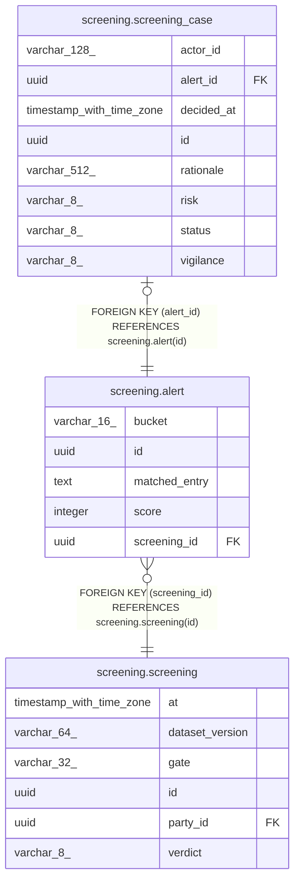

# screening.alert

## Columns

| Name          | Type        | Default | Nullable | Children                                                | Parents                                       | Comment |
| ------------- | ----------- | ------- | -------- | ------------------------------------------------------- | --------------------------------------------- | ------- |
| bucket        | varchar(16) |         | false    |                                                         |                                               |         |
| id            | uuid        |         | false    | [screening.screening_case](screening.screening_case.md) |                                               |         |
| matched_entry | text        |         | true     |                                                         |                                               |         |
| score         | integer     |         | false    |                                                         |                                               |         |
| screening_id  | uuid        |         | false    |                                                         | [screening.screening](screening.screening.md) |         |

## Constraints

| Name                    | Type        | Definition                                                                                                                                                                                                                   |
| ----------------------- | ----------- | ---------------------------------------------------------------------------------------------------------------------------------------------------------------------------------------------------------------------------- |
| alert_bucket_check      | CHECK       | CHECK (((bucket)::text = ANY ((ARRAY['SANCTION'::character varying, 'PEP'::character varying, 'AME'::character varying, 'RISK_COUNTRY'::character varying, 'UBO'::character varying, 'ORIAS'::character varying])::text[]))) |
| alert_pkey              | PRIMARY KEY | PRIMARY KEY (id)                                                                                                                                                                                                             |
| alert_screening_id_fkey | FOREIGN KEY | FOREIGN KEY (screening_id) REFERENCES screening.screening(id)                                                                                                                                                                |

## Indexes

| Name                | Definition                                                                     |
| ------------------- | ------------------------------------------------------------------------------ |
| alert_pkey          | CREATE UNIQUE INDEX alert_pkey ON screening.alert USING btree (id)             |
| idx_alert_screening | CREATE INDEX idx_alert_screening ON screening.alert USING btree (screening_id) |

## Relations

---

> Generated by [tbls](https://github.com/k1LoW/tbls)
