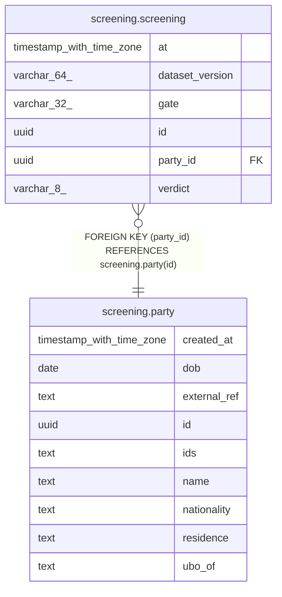

# screening.party

## Columns

| Name         | Type                     | Default | Nullable | Children                                      | Parents | Comment |
| ------------ | ------------------------ | ------- | -------- | --------------------------------------------- | ------- | ------- |
| created_at   | timestamp with time zone | now()   | false    |                                               |         |         |
| dob          | date                     |         | true     |                                               |         |         |
| external_ref | text                     |         | true     |                                               |         |         |
| id           | uuid                     |         | false    | [screening.screening](screening.screening.md) |         |         |
| ids          | text                     |         | true     |                                               |         |         |
| name         | text                     |         | false    |                                               |         |         |
| nationality  | text                     |         | true     |                                               |         |         |
| residence    | text                     |         | true     |                                               |         |         |
| ubo_of       | text                     |         | true     |                                               |         |         |

## Constraints

| Name       | Type        | Definition       |
| ---------- | ----------- | ---------------- |
| party_pkey | PRIMARY KEY | PRIMARY KEY (id) |

## Indexes

| Name       | Definition                                                         |
| ---------- | ------------------------------------------------------------------ |
| party_pkey | CREATE UNIQUE INDEX party_pkey ON screening.party USING btree (id) |

## Relations

---

> Generated by [tbls](https://github.com/k1LoW/tbls)
