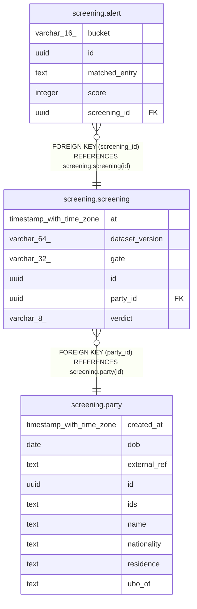

# screening.screening

## Columns

| Name            | Type                     | Default | Nullable | Children                              | Parents                               | Comment |
| --------------- | ------------------------ | ------- | -------- | ------------------------------------- | ------------------------------------- | ------- |
| at              | timestamp with time zone | now()   | false    |                                       |                                       |         |
| dataset_version | varchar(64)              |         | true     |                                       |                                       |         |
| gate            | varchar(32)              |         | false    |                                       |                                       |         |
| id              | uuid                     |         | false    | [screening.alert](screening.alert.md) |                                       |         |
| party_id        | uuid                     |         | false    |                                       | [screening.party](screening.party.md) |         |
| verdict         | varchar(8)               |         | false    |                                       |                                       |         |

## Constraints

| Name                    | Type        | Definition                                                                                               |
| ----------------------- | ----------- | -------------------------------------------------------------------------------------------------------- |
| screening_party_id_fkey | FOREIGN KEY | FOREIGN KEY (party_id) REFERENCES screening.party(id)                                                    |
| screening_pkey          | PRIMARY KEY | PRIMARY KEY (id)                                                                                         |
| screening_verdict_check | CHECK       | CHECK (((verdict)::text = ANY ((ARRAY['ALLOW'::character varying, 'HOLD'::character varying])::text[]))) |

## Indexes

| Name                | Definition                                                                     |
| ------------------- | ------------------------------------------------------------------------------ |
| idx_screening_party | CREATE INDEX idx_screening_party ON screening.screening USING btree (party_id) |
| screening_pkey      | CREATE UNIQUE INDEX screening_pkey ON screening.screening USING btree (id)     |

## Relations

---

> Generated by [tbls](https://github.com/k1LoW/tbls)
