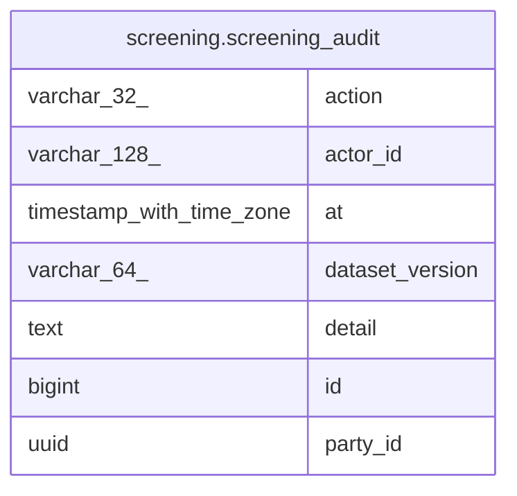

# screening.screening_audit

## Columns

| Name            | Type                     | Default | Nullable | Children | Parents | Comment |
| --------------- | ------------------------ | ------- | -------- | -------- | ------- | ------- |
| action          | varchar(32)              |         | false    |          |         |         |
| actor_id        | varchar(128)             |         | false    |          |         |         |
| at              | timestamp with time zone | now()   | false    |          |         |         |
| dataset_version | varchar(64)              |         | true     |          |         |         |
| detail          | text                     |         | true     |          |         |         |
| id              | bigint                   |         | false    |          |         |         |
| party_id        | uuid                     |         | true     |          |         |         |

## Constraints

| Name                 | Type        | Definition       |
| -------------------- | ----------- | ---------------- |
| screening_audit_pkey | PRIMARY KEY | PRIMARY KEY (id) |

## Indexes

| Name                      | Definition                                                                                 |
| ------------------------- | ------------------------------------------------------------------------------------------ |
| idx_screening_audit_party | CREATE INDEX idx_screening_audit_party ON screening.screening_audit USING btree (party_id) |
| screening_audit_pkey      | CREATE UNIQUE INDEX screening_audit_pkey ON screening.screening_audit USING btree (id)     |

## Relations

---

> Generated by [tbls](https://github.com/k1LoW/tbls)
