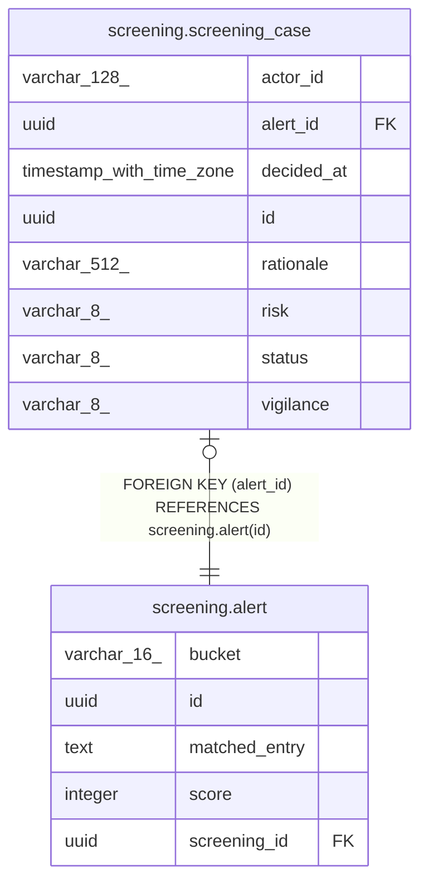

# screening.screening_case

## Columns

| Name       | Type                     | Default | Nullable | Children | Parents                               | Comment |
| ---------- | ------------------------ | ------- | -------- | -------- | ------------------------------------- | ------- |
| actor_id   | varchar(128)             |         | true     |          |                                       |         |
| alert_id   | uuid                     |         | false    |          | [screening.alert](screening.alert.md) |         |
| decided_at | timestamp with time zone |         | true     |          |                                       |         |
| id         | uuid                     |         | false    |          |                                       |         |
| rationale  | varchar(512)             |         | true     |          |                                       |         |
| risk       | varchar(8)               |         | true     |          |                                       |         |
| status     | varchar(8)               |         | false    |          |                                       |         |
| vigilance  | varchar(8)               |         | true     |          |                                       |         |

## Constraints

| Name                           | Type        | Definition                                                                                                                         |
| ------------------------------ | ----------- | ---------------------------------------------------------------------------------------------------------------------------------- |
| screening_case_alert_id_fkey   | FOREIGN KEY | FOREIGN KEY (alert_id) REFERENCES screening.alert(id)                                                                              |
| screening_case_alert_id_key    | UNIQUE      | UNIQUE (alert_id)                                                                                                                  |
| screening_case_pkey            | PRIMARY KEY | PRIMARY KEY (id)                                                                                                                   |
| screening_case_risk_check      | CHECK       | CHECK (((risk)::text = ANY ((ARRAY['WEAK'::character varying, 'MED'::character varying, 'STRONG'::character varying])::text[])))   |
| screening_case_status_check    | CHECK       | CHECK (((status)::text = ANY ((ARRAY['ACC'::character varying, 'REF'::character varying, 'PENDING'::character varying])::text[]))) |
| screening_case_vigilance_check | CHECK       | CHECK (((vigilance)::text = ANY ((ARRAY['NORMAL'::character varying, 'ENHANCED'::character varying])::text[])))                    |

## Indexes

| Name                        | Definition                                                                                         |
| --------------------------- | -------------------------------------------------------------------------------------------------- |
| screening_case_alert_id_key | CREATE UNIQUE INDEX screening_case_alert_id_key ON screening.screening_case USING btree (alert_id) |
| screening_case_pkey         | CREATE UNIQUE INDEX screening_case_pkey ON screening.screening_case USING btree (id)               |

## Relations

---

> Generated by [tbls](https://github.com/k1LoW/tbls)
