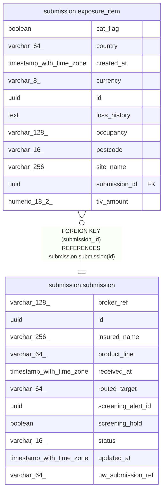

# submission.exposure_item

## Columns

| Name          | Type                     | Default | Nullable | Children | Parents                                           | Comment |
| ------------- | ------------------------ | ------- | -------- | -------- | ------------------------------------------------- | ------- |
| cat_flag      | boolean                  | false   | false    |          |                                                   |         |
| country       | varchar(64)              |         | false    |          |                                                   |         |
| created_at    | timestamp with time zone | now()   | false    |          |                                                   |         |
| currency      | varchar(8)               |         | false    |          |                                                   |         |
| id            | uuid                     |         | false    |          |                                                   |         |
| loss_history  | text                     |         | true     |          |                                                   |         |
| occupancy     | varchar(128)             |         | true     |          |                                                   |         |
| postcode      | varchar(16)              |         | true     |          |                                                   |         |
| site_name     | varchar(256)             |         | false    |          |                                                   |         |
| submission_id | uuid                     |         | false    |          | [submission.submission](submission.submission.md) |         |
| tiv_amount    | numeric(18,2)            |         | false    |          |                                                   |         |

## Constraints

| Name                             | Type        | Definition                                                       |
| -------------------------------- | ----------- | ---------------------------------------------------------------- |
| exposure_item_pkey               | PRIMARY KEY | PRIMARY KEY (id)                                                 |
| exposure_item_submission_id_fkey | FOREIGN KEY | FOREIGN KEY (submission_id) REFERENCES submission.submission(id) |

## Indexes

| Name                         | Definition                                                                                        |
| ---------------------------- | ------------------------------------------------------------------------------------------------- |
| exposure_item_pkey           | CREATE UNIQUE INDEX exposure_item_pkey ON submission.exposure_item USING btree (id)               |
| idx_exposure_item_submission | CREATE INDEX idx_exposure_item_submission ON submission.exposure_item USING btree (submission_id) |

## Relations

---

> Generated by [tbls](https://github.com/k1LoW/tbls)
