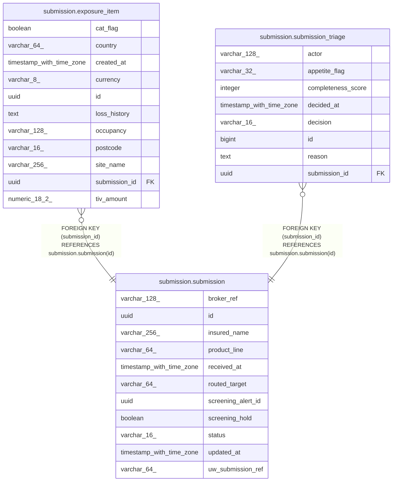

# submission.submission

## Columns

| Name               | Type                     | Default | Nullable | Children                                                                                                                | Parents | Comment |
| ------------------ | ------------------------ | ------- | -------- | ----------------------------------------------------------------------------------------------------------------------- | ------- | ------- |
| broker_ref         | varchar(128)             |         | false    |                                                                                                                         |         |         |
| id                 | uuid                     |         | false    | [submission.exposure_item](submission.exposure_item.md) [submission.submission_triage](submission.submission_triage.md) |         |         |
| insured_name       | varchar(256)             |         | false    |                                                                                                                         |         |         |
| product_line       | varchar(64)              |         | false    |                                                                                                                         |         |         |
| received_at        | timestamp with time zone | now()   | false    |                                                                                                                         |         |         |
| routed_target      | varchar(64)              |         | true     |                                                                                                                         |         |         |
| screening_alert_id | uuid                     |         | true     |                                                                                                                         |         |         |
| screening_hold     | boolean                  | false   | false    |                                                                                                                         |         |         |
| status             | varchar(16)              |         | false    |                                                                                                                         |         |         |
| updated_at         | timestamp with time zone | now()   | false    |                                                                                                                         |         |         |
| uw_submission_ref  | varchar(64)              |         | true     |                                                                                                                         |         |         |

## Constraints

| Name                    | Type        | Definition                                                                                                                                                                |
| ----------------------- | ----------- | ------------------------------------------------------------------------------------------------------------------------------------------------------------------------- |
| submission_pkey         | PRIMARY KEY | PRIMARY KEY (id)                                                                                                                                                          |
| submission_status_check | CHECK       | CHECK (((status)::text = ANY ((ARRAY['RECEIVED'::character varying, 'TRIAGED'::character varying, 'ROUTED'::character varying, 'DECLINED'::character varying])::text[]))) |

## Indexes

| Name            | Definition                                                                    |
| --------------- | ----------------------------------------------------------------------------- |
| submission_pkey | CREATE UNIQUE INDEX submission_pkey ON submission.submission USING btree (id) |

## Relations

---

> Generated by [tbls](https://github.com/k1LoW/tbls)
