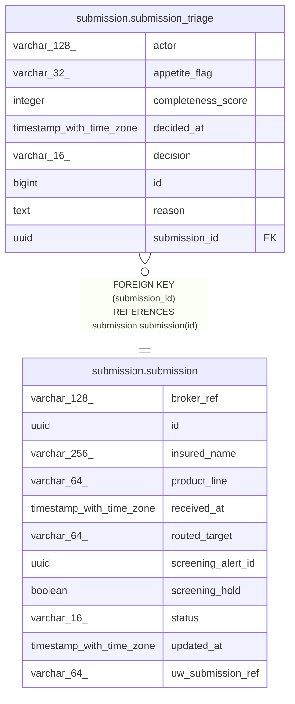

# submission.submission_triage

## Columns

| Name               | Type                     | Default | Nullable | Children | Parents                                           | Comment |
| ------------------ | ------------------------ | ------- | -------- | -------- | ------------------------------------------------- | ------- |
| actor              | varchar(128)             |         | false    |          |                                                   |         |
| appetite_flag      | varchar(32)              |         | true     |          |                                                   |         |
| completeness_score | integer                  |         | true     |          |                                                   |         |
| decided_at         | timestamp with time zone | now()   | false    |          |                                                   |         |
| decision           | varchar(16)              |         | false    |          |                                                   |         |
| id                 | bigint                   |         | false    |          |                                                   |         |
| reason             | text                     |         | true     |          |                                                   |         |
| submission_id      | uuid                     |         | false    |          | [submission.submission](submission.submission.md) |         |

## Constraints

| Name                                 | Type        | Definition                                                                                                                                |
| ------------------------------------ | ----------- | ----------------------------------------------------------------------------------------------------------------------------------------- |
| submission_triage_decision_check     | CHECK       | CHECK (((decision)::text = ANY ((ARRAY['ROUTE'::character varying, 'DECLINE'::character varying, 'RETURN'::character varying])::text[]))) |
| submission_triage_pkey               | PRIMARY KEY | PRIMARY KEY (id)                                                                                                                          |
| submission_triage_submission_id_fkey | FOREIGN KEY | FOREIGN KEY (submission_id) REFERENCES submission.submission(id)                                                                          |

## Indexes

| Name                             | Definition                                                                                                |
| -------------------------------- | --------------------------------------------------------------------------------------------------------- |
| idx_submission_triage_submission | CREATE INDEX idx_submission_triage_submission ON submission.submission_triage USING btree (submission_id) |
| submission_triage_pkey           | CREATE UNIQUE INDEX submission_triage_pkey ON submission.submission_triage USING btree (id)               |

## Relations

---

> Generated by [tbls](https://github.com/k1LoW/tbls)
